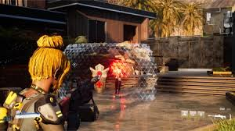
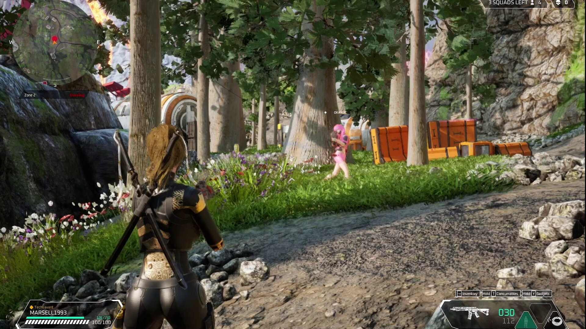
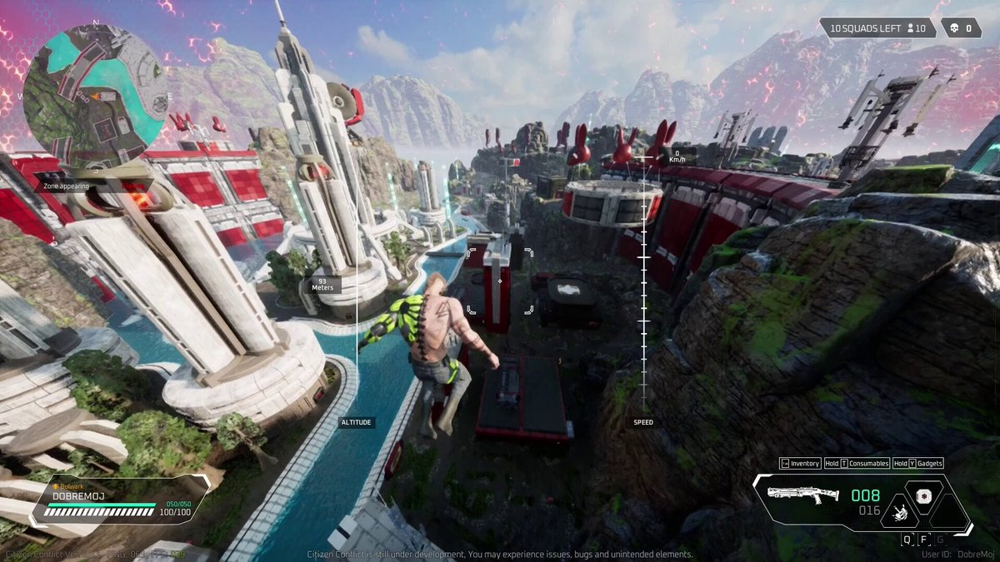
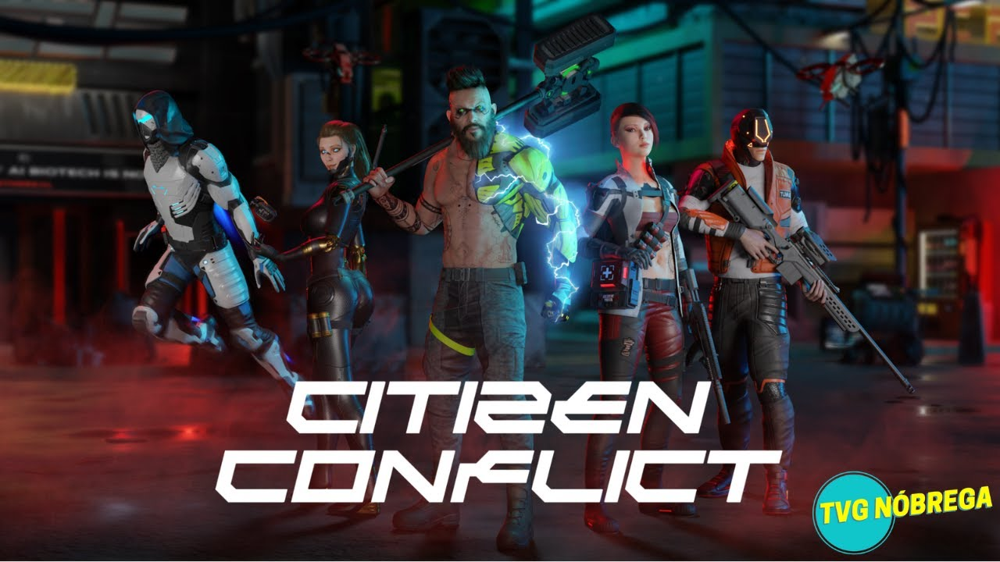
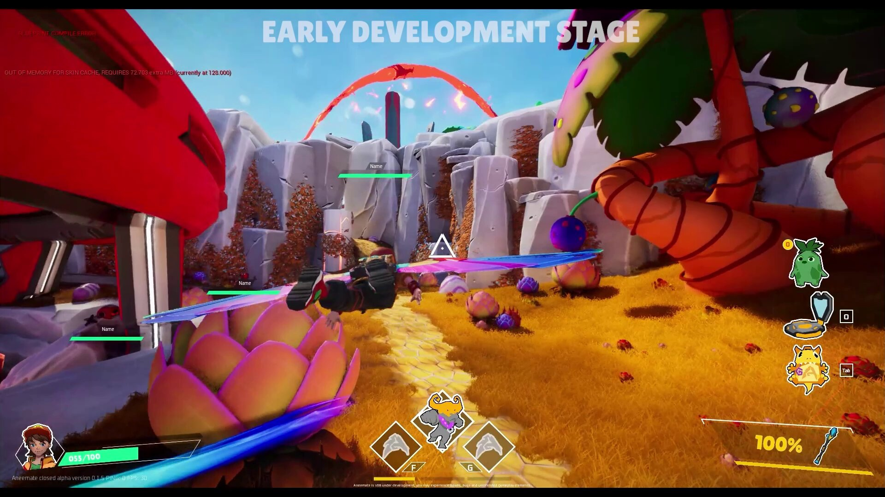
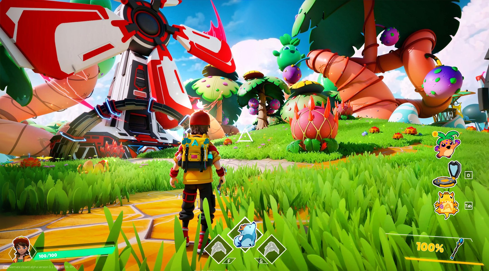
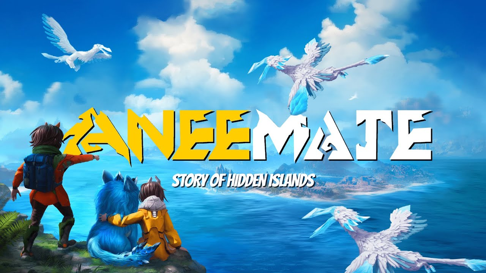

As a System & Network Programmer, I worked on two released multiplayer titles built in Unreal Engine: **Citizen Conflict**, a hero shooter with arena and Battle Royale modes, and **AneeMate**, an extraction shooter with a creature-capturing twist. Both games shared an internal framework, so much of my work carried over between the two projects.

## What I did

### Abilities & character mechanics
I developed, maintained and refined player abilities and mechanics so they fit seamlessly into the gameplay. One example is the **Tactical Sprint**, a faster version of the standard sprint that costs stamina to activate, with its own custom effects, fully synchronized over the network.

### Performance & network optimization
I profiled both games with Unreal Insights and other tools to find and remove bottlenecks, mainly on the networking and CPU side.

* **Networking** - cut down network calls by reusing already replicated properties and reduced the overall data footprint, lowering latency and improving the experience for players.
* **CPU** - optimized gameplay mechanics, shortened load times and removed bottlenecks affecting frame rate.

### Prototyping with designers
I worked closely with game designers to prototype new systems quickly, so ideas could be tested, iterated on and judged for feasibility early.

### Internal framework
I maintained and improved an internal framework reused across multiple games, which made prototyping new ideas faster for the whole team.

### Stability & bug fixing
I fixed bugs across existing systems, from performance issues to unintended behavior, to keep the games stable and polished for live players.

## Citizen Conflict

Citizen Conflict is a hero shooter with fast-paced arena action and large-scale Battle Royale battles. Three rival factions, each with unique heroes, fight for dominance in a futuristic world full of high-tech maps, advanced weaponry and unconventional gear.

**Arena** - 5v5, 3v3v3 and 1v1 matches across a variety of maps, each with its own layouts, cover and tactical opportunities.

  
  

**Battle Royale** - solo or squad play where 32 teams drop in, scavenge for loot and fight to be the last one standing as the map keeps shrinking.

  
  
  

[Citizen Conflict on the Epic Games Store](https://store.epicgames.com/en-US/p/citizen-conflict-95e40e)

## AneeMate

AneeMate is an extraction shooter where players aren't the only threat - dangerous robots, hostile environments and wild creatures lurk around every corner. Bring your own AneeMate to support you in battle, capture new ones for future runs, and explore the map for hidden secrets, powerful weapons and gadgets.

  
  
  

[AneeMate on the Epic Games Store](https://store.epicgames.com/en-US/p/aneemate-896b7e)
