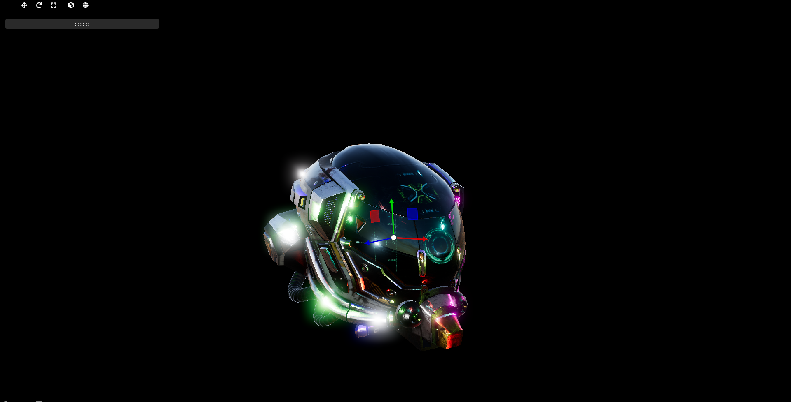
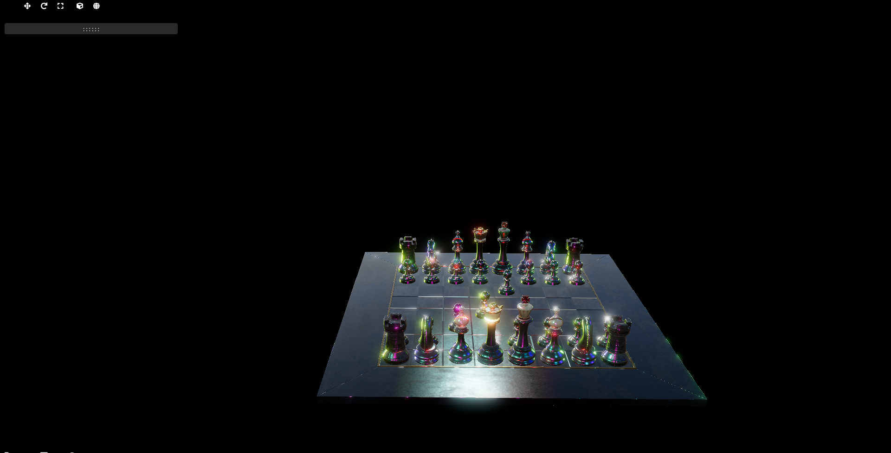
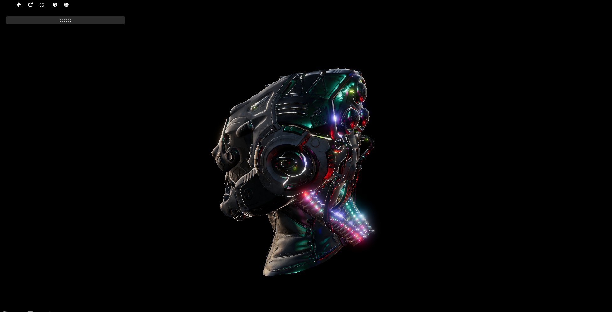

A Physically Based Rendering (PBR) renderer designed for the PlayStation 5 and DirectX 12 on PC, leveraging advanced rendering techniques to achieve realistic lighting and material effects. It uses the glTF format for models, ensuring efficient asset management and compatibility with a wide range of 3D content creation tools.

  
  
  

## Post-processing

The renderer implements a few post-process effects, including bloom and tone mapping.
